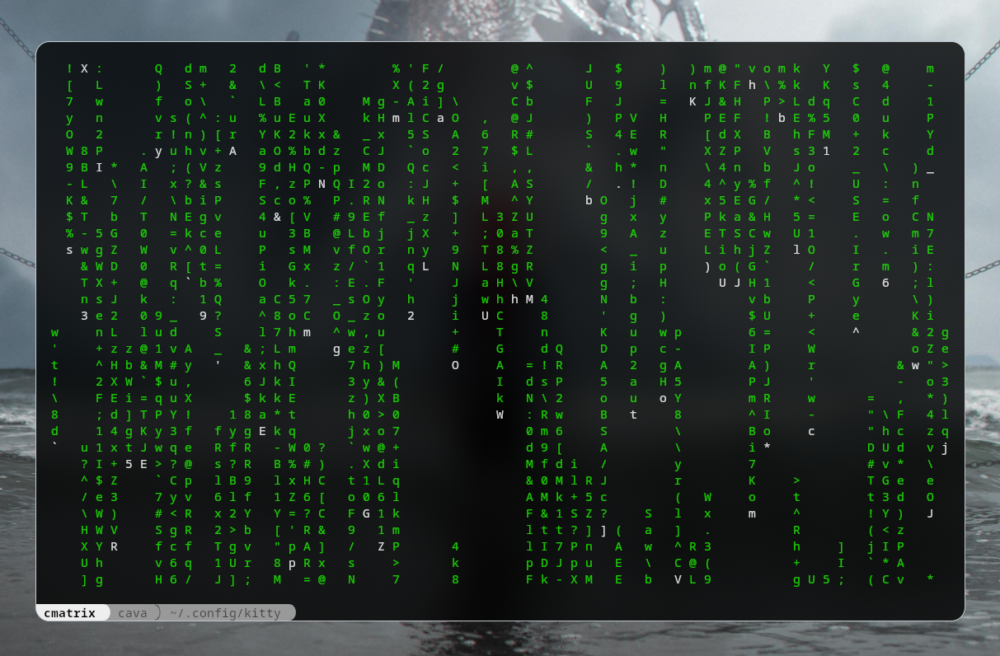
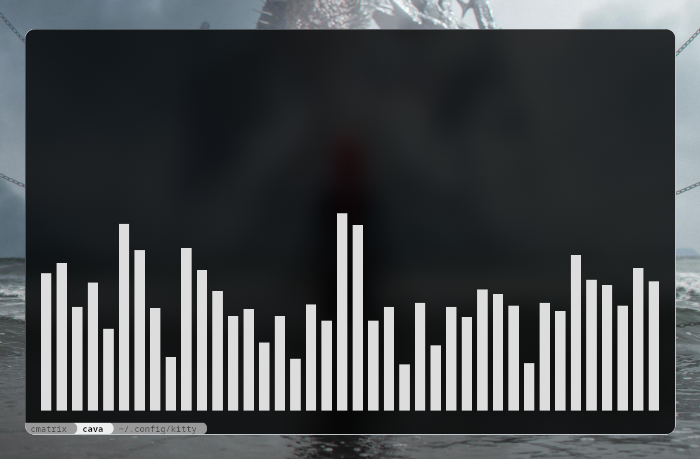
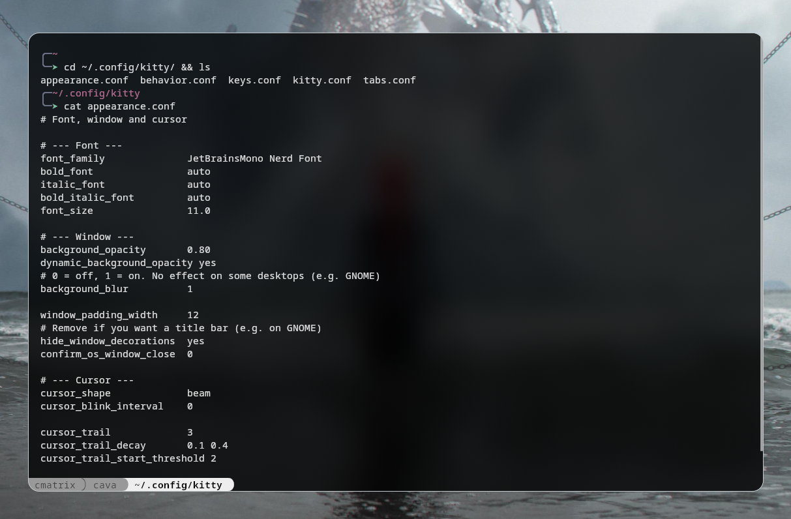

# kitty-tiling-config

A compact [kitty](https://sw.kovidgoyal.net/kitty/) terminal config **for tiling window managers**: translucent blurred window, cursor trail, rounded tabs and handy shortcuts. Split into small files so it is easy to read and edit.

> **Tiling, not GNOME.** This config is built for tiling environments and tested on Niri. On regular desktop environments (e.g. GNOME) some settings do not work, see [Compatibility](#compatibility).

<p>
  
  
  
</p>

**Navigation:** [Features](#features) · [Requirements](#requirements) · [Install](#install) · [Files](#files) · [Shortcuts](#shortcuts) · [Compatibility](#compatibility) · [License](#license)

## Features

- Translucent window with background blur and on-the-fly opacity control
- Animated cursor trail
- Rounded powerline tab bar (shown from two tabs)
- Jump to a tab with `Ctrl+Shift+1…9`
- Config split by purpose: look, tabs, behavior, keys

## Requirements

- kitty (0.37 or newer for the cursor trail)
- [JetBrainsMono Nerd Font](https://www.nerdfonts.com/): needed for the font itself and for the tab bar glyphs

## Install

Back up your current config first:

```sh
cp -r ~/.config/kitty ~/.config/kitty.bak
```

Then copy the files and reload kitty with `Ctrl+Shift+F5`:

```sh
git clone https://github.com/Kernovain/kitty-tiling-config.git
cp kitty-tiling-config/kitty/*.conf ~/.config/kitty/
```

## Files

| File | What it controls |
|---|---|
| `kitty.conf` | Entry point, only `include` lines |
| `appearance.conf` | Font, window, opacity, blur, cursor |
| `tabs.conf` | Tab bar look |
| `behavior.conf` | Scrollback, bell, selection, links, shell integration |
| `keys.conf` | All keyboard shortcuts |

If an option appears twice, the one included later in `kitty.conf` wins.

## Shortcuts

kitty's default shortcuts still work. Added or changed here:

| Keys | Action |
|---|---|
| `Ctrl+Shift+Enter` | New window |
| `Ctrl+Shift+W` | Close window |
| `Ctrl+Shift+F11` | Toggle fullscreen |
| `Ctrl+Shift+1…9` | Go to tab 1…9 |
| `Ctrl+Shift+C` / `V` | Copy / paste |
| `Ctrl+Plus` / `Minus` / `Backspace` | Font size: bigger / smaller / reset |
| `Ctrl+Shift+A`, then `M` / `L` | Opacity: more opaque / more transparent |
| `Ctrl+Shift+A`, then `1` / `D` | Opacity: fully opaque / back to the config value |

The `A` shortcuts are a sequence: press `Ctrl+Shift+A`, release, then press the second key.

## Compatibility

Tested on Niri. Other environments may differ:

- **GNOME:** background blur has no effect, and `hide_window_decorations yes` removes the title bar, so you lose the window controls. If you need them, comment out that line in `appearance.conf` (put a `#` at the start).
- `background_blur` works as a plain on/off switch in Niri (`1` on, `0` off); the number does not change the blur strength. It may behave differently in other environments.

## License

MIT
